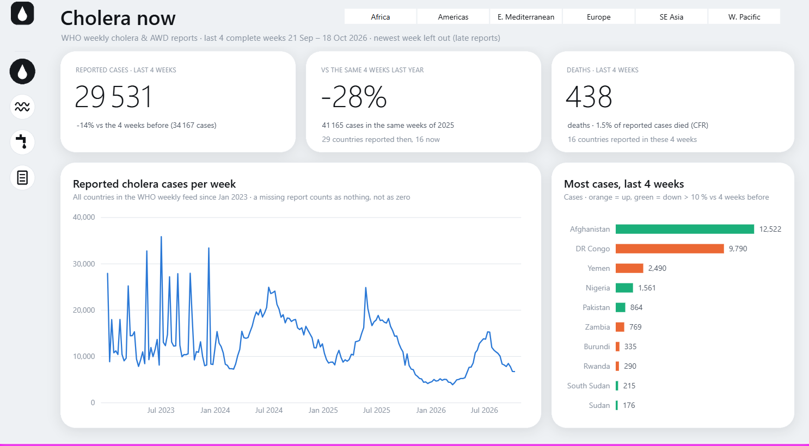
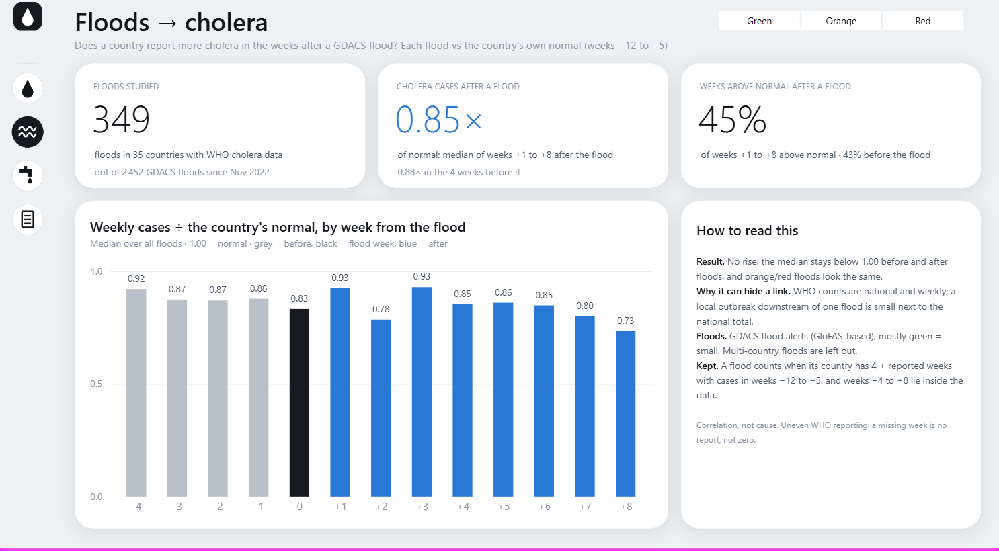
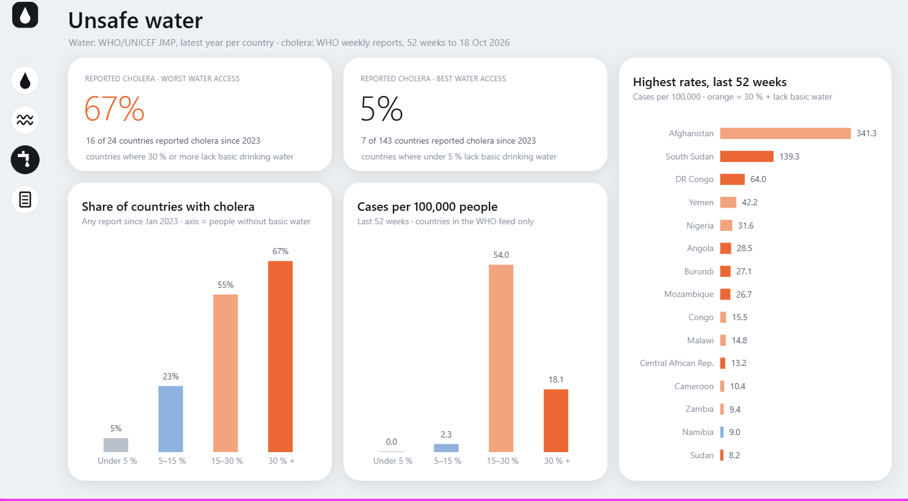
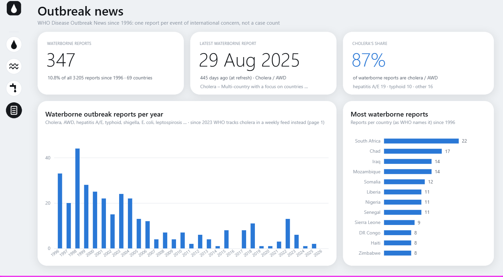

# Infected Waterways

**Status:** Milestones 1–6 done (river graph + trace, live data layer, spread simulator, Haiti 2010 validation, relative risk index, Power BI report), 2026-11-17. Private repo.

**Live (Tailscale only):** http://100.108.59.90:8796/ on the Pi (service `waterways-web`).

**What it answers:** *how far and how fast does contamination travel down a river, and who lives on that path?*
You pick a release point on any of the world's rivers. The model follows the water to the sea using real flow
data and shows arrival time at each place, dilution and die-off, and the people living along the stretch that
still carries it - with a relative risk index for those who drink unsafe water.

**What it does not answer:** how many people would fall ill or die. That needs an infective dose, a dose-response
curve, how much river water people drink, and an attack rate for the same kind of exposure - none of which is
known per place. An earlier version multiplied published numbers into case and death counts (Milestone 3b); the
Haiti 2010 validation showed the exposure step alone can be far off, so the counts were removed (Milestone 5).

**How sure it is:** travel time is calibrated on 6 reported arrival times (typical error ×1.17) and tested out of
sample on the Haiti 2010 cholera epidemic: path, order and timing pass; the speed of spread across a delta and
the 5 km exposure proxy fail, for reasons that are named (`docs/VALIDATION.md`).

**Ethics rule:** every simulated scenario is labelled **SIMULATED / HYPOTHETICAL** on every map, chart and
export. Real outbreak data (WHO and others) stays visually separate from the simulation.

## Pathogens (simulation parameters)
Cholera (*V. cholerae*), Typhoid, Hepatitis A/E, plus a generic chemical tracer for validation.
SARS-CoV-2 only shows up in the wastewater early-warning layer, because it doesn't spread through rivers.

## Milestones
| # | Milestone | Output |
|---|---|---|
| 0 | Planning + source check | `docs/SOURCES.md`, this README ✅ |
| 1 | World waterways map + river graph | ✅ Web map (rivers ≥ 10 m³/s, 1,131 named main stems, 1,708 HydroLAKES ≥ 100 km², OSM waterways at zoom ≥ 7, satellite/Sentinel-2/3D terrain); 2,369,127 HydroRIVERS reaches (≥ 1 m³/s) in PostGIS; downstream trace API (path, travel time, countries incl. border rivers, cities, lakes); 11 historic outbreaks + spills with sources; velocity calibrated on 6 reported arrival times (`docs/CALIBRATION.md`) |
| 2 | Real-data layer | ✅ Daily collector on the Pi: WHO weekly cholera by country (2023–now), WHO Disease Outbreak News (3,205 reports since 1996, 347 waterborne), GDACS floods, GloFAS river flow at 150 virtual gauges vs. the same season of the previous 5 years, WHO drinking-water coverage for 226 countries; GHS-POP 2025 population (people within 5 km of each trace); KPI panel with comparison periods |
| 3 | Spread simulator | ✅ Release anywhere: relative concentration = dilution (Q₀/Q) × die-off 10^(−t/T90), per pathogen with fast/typical/slow T90 from the literature; lakes add their residence time; optional today's flow from GloFAS; KPIs: km and days until 99.9 % gone, people and cities on that stretch |
| 3b | Outbreak scenario | ⛔ Superseded by M5 (2026-11-17): it turned exposure into ill and dead counts by multiplying four uncertain factors |
| 4 | Validation | ✅ Out of sample on Haiti 2010 (`build/validate_haiti.py` → `docs/VALIDATION.md`), criteria fixed before the run: timing ✅, flow ✅, simultaneity across the delta ❌, exposure contrast ❌. Songhua 2005 is a calibration point (M1), not a test |
| 5 | Relative risk index | ✅ The **Risk** tab: people on unsafe water along the contaminated stretch as an order-of-magnitude band with a fast–slow range, compared with the Artibonite 2010 path, plus the blind spots the validation found. No case or death counts |
| 6 | Dashboard | ✅ Power BI report, 4 pages: cholera now (last 4 weeks vs. the 4 before and vs. last year), floods → cholera event study (2,454 GDACS floods backfilled to Nov 2022), unsafe drinking water vs. cholera, WHO outbreak news since 1996 |
| 7 | Showcase scenarios | e.g. Lancang→Mekong→Tonle Sap seasonal flow reversal, Ganges–Brahmaputra delta, Niger, Danube |

## How it works
1. **River graph.** HydroRIVERS v1.0: every reach has `NEXT_DOWN`, the reach it flows into. The 2,369,127 reaches with
   mean flow ≥ 1 m³/s (`ORD_FLOW ≤ 6`) are loaded into PostGIS (table `rivers`). Flow order only grows downstream, so
   this subset is closed under `NEXT_DOWN`: every trace reaches the sea or an inland sink.
2. **Trace.** `GET /api/trace?lon&lat` snaps the click to the nearest reach (≤ 25 km), follows `NEXT_DOWN` with a recursive
   CTE, and adds per reach: distance, mean discharge, speed and arrival time. Along the path it also lists the countries
   (2 countries within 2.5 km of a reach = border river; runs < 12 km are dropped as noise), Natural Earth cities
   within 8 km, and HydroLAKES ≥ 5 km² with their residence time. Typical response 0.3–3 s on the Pi 4.
3. **Travel time.** Reach speed v = a · Q^b m/s (Leopold & Maddock 1953). Fitted on 6 reported arrival times
   (Baia Mare cyanide 2000: 3 checkpoints; Songhua benzene 2005; Rio Doce tailings 2015; Rhine water Rheinfelden→Lobith).
   Leave-one-out cross-validation chose **a = 0.10, b = 0.30**. Typical out-of-sample error is a factor of ×1.17. See `docs/CALIBRATION.md`.
4. **History.** `build/events.json`: 7 waterborne outbreaks + 4 river contamination events, each hand-checked with
   WHO / PAHO / UNEP / CDC / peer-reviewed sources. `build/build_events.py` traces each one and writes the map layers.

5. **The world now (Milestone 2).** `pi/collect/collect_live.py` runs daily at 07:20 (`waterways-collect.timer`):

   | Source | What | Access |
   |---|---|---|
   | [WHO Global Cholera and AWD dashboard](https://who-global-cholera-and-awd-dashboard-1-who.hub.arcgis.com/) | weekly cholera cases and deaths per country since 2023 (public CSV item `cholera_adm0_week`) | open, no key |
   | [WHO Disease Outbreak News API](https://www.who.int/api/news/diseaseoutbreaknews) | every outbreak report since 1996, classified waterborne / other, matched to a country | open, no key, 100 per page |
   | [GDACS](https://www.gdacs.org/) | flood events of the last 120 days, all alert levels | open, no key, 100 per page |
   | [Open-Meteo Flood API](https://open-meteo.com/en/docs/flood-api) (GloFAS v4) | daily discharge at 150 virtual gauges near the mouths of the largest systems: last 30 days + 7-day forecast, and the same ±15 days in each of the previous 5 years | open, CC BY 4.0, non-commercial, ~1,000 weighted calls/day |
   | [GHS-POP R2023A](https://human-settlement.emergency.copernicus.eu/ghs_pop2023.php), epoch 2025 | population grid (30″, aggregated to 0.025°) for "people within 5 km of the river" | open, CC BY 4.0, one-time |

   KPIs (`GET /api/live`), each with a comparison: cholera cases in the last 4 weeks vs. the 4 weeks before; countries reporting;
   cases this year vs. the same weeks last year; current river floods; big rivers above / below normal for the season;
   people living within 5 km of a river ≥ 1 m³/s; countries with cholera **and** a river flood right now.
   The cholera window ends one week before the newest reported week because reports arrive late.

6. **Spread simulator (Milestone 3).** In the trace panel: relative concentration after full mixing at the release point =
   dilution by tributaries (Q₀/Q) × die-off 10^(−t/T90). Every pathogen has three T90 values (fast / typical / slow), because
   published river-water decay rates vary by orders of magnitude with sunlight, temperature and sediment:

   | Pathogen | T90 fast / typical / slow (days) | Basis |
   |---|---|---|
   | Vibrio cholerae | 1 / 3 / 32 | no reference value for river water (data gap in the Global Water Pathogen Project); 32 d = survival in riverbed sediment (PubMed 27193001) |
   | Salmonella Typhi | 0.5 / 4 / 48 | GWPP: < 1 h in sunlit water, 48–96 d in the dark at 15 °C |
   | Hepatitis A virus | 2.6 / 10 / 33 | Boehm et al. 2019 meta-analysis: mammalian viruses k = 0.07–0.9 / day in surface water |
   | E. coli (indicator) | 0.5 / 2 / 7 | GWPP: T90 2.2 d sunlit at 15 °C, < 7 d at 20–30 °C |
   | Cryptosporidium | 5 / 40 / 86 | GWPP: T90 38–86 d dark at 20–25 °C |
   | Chemical (no decay) | – | dilution only, as in the spills used for calibration |

   The "typical" value is our central assumption between the published extremes. Lakes on the path add their residence time
   to the die-off clock. "Today's flow" scales every reach by the river's current GloFAS anomaly (travel time ∝ r^−b).
   Output: km and days until 99.9 % is gone, people within 5 km of that stretch, cities on it, concentration curve with the
   fast–slow band. Ignores sediment storage, regrowth in estuaries and water treatment. Labelled **HYPOTHETICAL**.

Every trace on the map is labelled **SIMULATED · MEAN FLOW**. It uses long-term mean flow, so it is not a forecast.

7. **Validation on Haiti 2010 (Milestone 4).** `build/validate_haiti.py` traces from the UN camp stream at Meille, where the
   epidemic started, and tests the result against Piarroux et al. 2011 (*Emerging Infectious Diseases* 17(7)). Haiti was not used
   for calibration, and the four criteria are fixed in the script before it runs:

   | Test | Result | |
   |---|---|---|
   | P1 timing | pass | the front reaches Desarmes, the head of the delta, after 1.5 d, so a delta onset on Oct 19 implies a release on Oct 13-18, inside the window the camp was contaminating (Oct 12-19). A weak test: anything up to 6.5 d would pass |
   | P2 simultaneity | **fail** | one channel's front needs 1.95 d to cross the delta; the delta fell ill within a day. Irrigation canals spread river water across it at once |
   | P3 exposure contrast | **fail** | people per river-km within 5 km are only ×1.8 higher in the delta than in the middle valley (needed ×3; observed cases: thousands vs. 0-2). Four of the seven struck communes have their town 6-11 km from the channel |
   | P4 flow | pass | 135 m³/s mean flow at the mouth; the paper: usually > 100 m³/s in October |

   Read: the model gets *where* and *in what order* right, and *when* within its error. It cannot see canals, and a flat 5 km
   band is a poor proxy for who drinks the river. Hence Milestone 5.

8. **Relative risk index (Milestone 5).** The **Risk** tab shows one measured quantity: people within 5 km of the stretch that
   still carries ≥ 0.1 % of the release, times the share of their country's people on **unimproved or surface water** (WHO GHO
   `WSH_WATER_BASIC`, all 226 countries; "not safely managed" is offered too but covers only 158). It is shown as a band
   (Very low < 1 k, Low, Moderate, High, Very high ≥ 1 M), with the range from fast to slow die-off, next to the Artibonite 2010
   path measured the same way (≈ 160 k). Where they apply, the panel lists the blind spots: a stretch that reaches a delta,
   lakes on the way, people without a WHO figure. Examples, cholera at mean flow: Artibonite from Meille **High** (×1.0),
   upper Ganges at Haridwar **Low** (4 k; 3 k-385 k), Rhine at Basel **Very low** (0).

   The scenario is a contamination event - a flood-driven sewage overflow, a failed treatment plant, an untreated discharge.
   It is labelled HYPOTHETICAL · NOT A FORECAST and ranks places for preparedness; it does not count the ill or the dead.

9. **Power BI report (Milestone 6).** `powerbi/InfectedWaterways.pbip` looks at the real-world data around the map: what is
   reported now, whether floods are followed by cholera, and how drinking-water access lines up with it. The Pi's Postgres
   only listens on localhost, so the report reads CSV snapshots: `sql/04_bi.sql` defines read-only `bi` views,
   `build/export_bi.py` copies them over SSH into `powerbi/data/`, and `build/gen_pbip.py` generates the report
   (same light design as the Sky & Sea report). Numbers below: WHO data up to the week of 12 Oct 2026.

   - **Cholera now.** 29,531 reported cases in the last 4 complete weeks (21 Sep – 18 Oct 2026): −14 % vs. the 4 weeks
     before, −28 % vs. the same weeks of 2025. 438 deaths (1.5 % of reported cases). Only 16 countries reported, vs. 29 a
     year earlier, so part of the fall is fewer reports. The newest week is left out everywhere because late reports
     make it look like a crash.
   - **Floods → cholera: no link visible.** 349 floods in 35 countries with WHO cholera data, each compared with that
     country's own normal (mean reported weekly cases in weeks −12 to −5). Median weekly cases stay at 0.73–0.93× normal
     from 4 weeks before to 8 weeks after the flood (0.85× after, 0.88× before), and orange/red floods look the same.
     National weekly totals can hide a local outbreak downstream of one flood, so this is "not visible at this
     resolution", not "no effect".
   - **Unsafe water.** 16 of 24 countries (67 %) where 30 % or more of people lack basic drinking water reported cholera
     since 2023, vs. 7 of 143 (5 %) where under 5 % lack it. Cases per 100,000 people (last 52 weeks) by water-access
     group and the 15 highest national rates.
   - **Outbreak news.** 347 waterborne WHO Disease Outbreak News reports since 1996 (10.8 % of 3,205); 87 % are cholera
     or acute watery diarrhoea. Few after 2022 because WHO tracks cholera in its weekly feed instead.

   Correlation, not cause; WHO reporting is uneven, and a missing week means no report, not zero cases.

   | | |
   |---|---|
   |  |  |
   |  |  |

## Run / deploy
```
python -m venv .venv && .venv/Scripts/python -m pip install geopandas pyogrio pyarrow
# data/raw/: HydroRIVERS_v10_<region>_shp.zip (8 regions), HydroLAKES_polys_v10_shp.zip,
#            ne_10m_rivers_lake_centerlines.zip, ne_10m_lakes.zip, ne_10m_populated_places.zip, ne_10m_admin_0_countries.zip
.venv/Scripts/python build/build_rivers.py      # web/data/rivers_t1/t2/t3_<region>.geojson
.venv/Scripts/python build/build_mainstems.py   # main stems + names
.venv/Scripts/python build/build_lakes.py       # HydroLAKES >= 100 km2
.venv/Scripts/python build/export_pg.py         # rivers -> csv.gz for PostGIS
.venv/Scripts/python build/export_layers.py     # places, countries, lakes, main stems -> csv.gz
# on the Pi: sql/01_schema.sql, pi/load.sh, sql/02_indexes.sql; service: pi/systemd/waterways-web.service
.venv/Scripts/python build/build_events.py      # traces + calibration (needs the API)
.venv/Scripts/python build/build_pop.py         # GHS-POP 2025 -> pop.csv.gz; on the Pi: pi/load_pop.sh
.venv/Scripts/python scripts/push_to_pi.py [--server]   # web/ (+ .gz twins) -> /mnt/ssd/waterways/web/site
# on the Pi: sql/03_live.sql, then python3 pi/collect/collect_live.py --setup-gauges (once, ~20 min),
#            pi/systemd/waterways-collect.{service,timer} (daily 07:20)
#            python3 pi/collect/collect_live.py --backfill-floods 2023-01-01   (once: GDACS history)
# Power BI: sql/04_bi.sql on the Pi (bi views), then
python build/export_bi.py                       # bi views -> powerbi/data/*.csv (over SSH)
py build/gen_pbip.py                            # regenerates powerbi/InfectedWaterways.pbip (Pillow); then Refresh in Desktop
```
Map: MapLibre GL 5.24.0 on a custom OpenFreeMap (OpenMapTiles) style. It offers Esri World Imagery, Sentinel-2 cloudless 2025 (EOX),
AWS Terrain Tiles hillshade/3D, maplibre-contour contour lines, and a globe view.
Deep links: `?trace=lon,lat`, `?event=<id>`, `?river=<name>`, `?base=esri|s2`, `?3d=1`, `?panel=cholera|floods|flow|people`, `?pathogen=cholera|typhoid|hepa|ecoli|crypto|tracer`, `?mode=explore|trace|risk` (old links: `outbreak`), `?exposure=basic|safe`.

Zoom: HydroRIVERS (a ~500 m model network that carries the flow data) fades out from zoom 7.5 to 10 and OpenStreetMap water areas and river lines take over, so the zoomed-in map shows the real banks.

See `docs/SOURCES.md` (access test of every source) and `docs/DATA_ASSESSMENT.md` (login sources, WEL outbreak data).

## Data layers (and what this is not)
Raw downloads and API pulls land in `data/raw` (one-off reference grids) or go straight into typed PostGIS tables
(`cholera_week`, `don_reports`, `floods`, `gauges`, `gauge_flow`, `wash`, `country_pop`, `pop`, `rivers`, …). KPIs and the risk
index are computed **on read**: `/api/live` runs the aggregations per request and caches the result for 10 minutes,
`/api/trace` walks the river graph per click, and the simulator and risk index run in the browser.

This is deliberately **not** a medallion lakehouse like `SkyAndSeaLakehouse` or `MacroConflictLakehouse`: there is no
immutable bronze landing zone for the daily API pulls and no materialised gold table. The data is small (the largest
table is 6.9 m population cells) and every KPI is a sub-second query, so a served layer would only add staleness.
The trade-off is real and worth naming: if WHO silently revises a past week, there is no raw copy to replay, and the
collector overwrites in place. Adding a bronze landing (one gzipped response per source per day on the SSD) is the
first thing to do if this project ever needs to reproduce a number as it stood on a given date.

## Planned stack
PostGIS 3.5 on Postgres 17, database `waterways`, data on the Pi SSD `/mnt/ssd`. The SSD moves to the Pi 5 when it arrives. Stdlib Python + psycopg 3 API → web map; `bi` views → CSV snapshots → Power BI report.

## Layout
- `build/` scripts that turn raw downloads into `web/data/`
- `web/` the map (MapLibre GL 5.24.0, OpenFreeMap dark basemap)
- `collectors/` API pulls (WHO DON, GHO, GDACS, Open-Meteo flood)
- `sql/` PostGIS schema + indexes, `04_bi.sql` views for the report
- `powerbi/` the Power BI project (`InfectedWaterways.pbip`) and its CSV snapshots in `powerbi/data/`
- `images/` report screenshots
- `pi/` loader, systemd unit, trace API server (`pi/web/waterways_web.py`)
- `scripts/` deploy (`push_to_pi.py`)
- `data/raw`, `data/processed` (git-ignored once a repo exists)
- `notebooks/` exploration
- `docs/` source inventory, method notes
